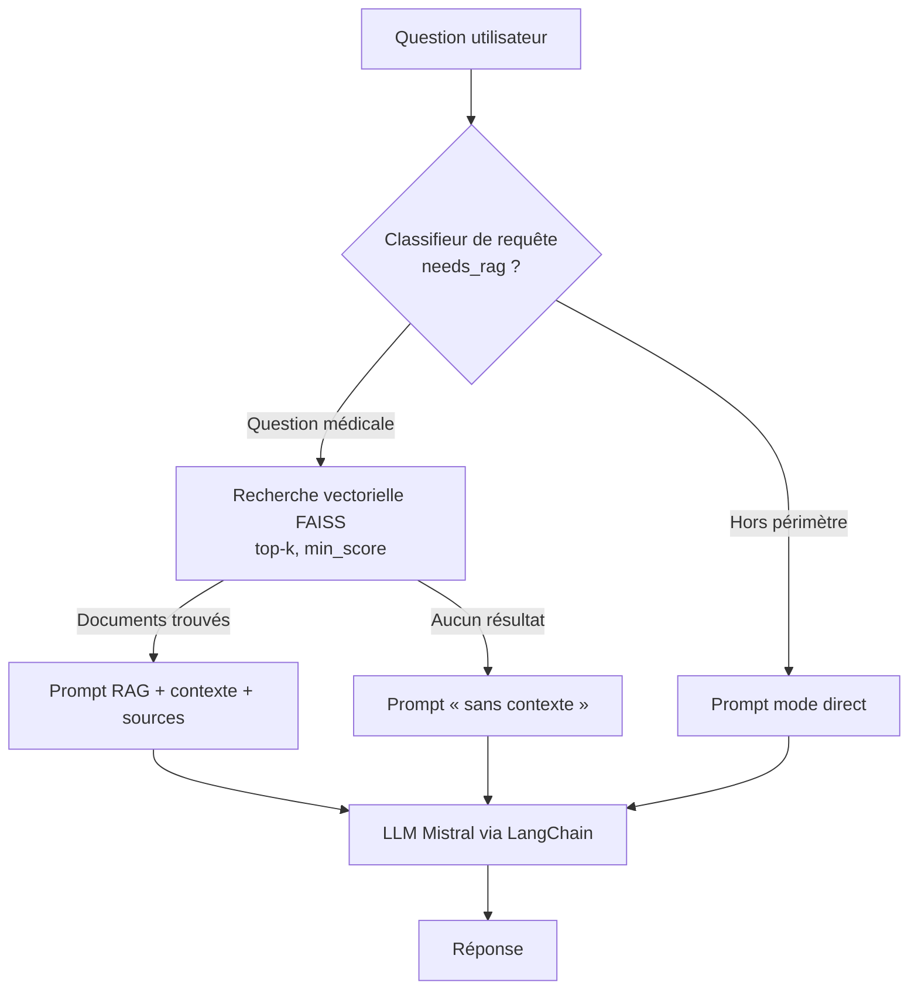

# 🌿 Toumöla RAG

**Assistant conversationnel basé sur le RAG (Retrieval-Augmented Generation) pour la santé par les plantes médicinales de Guinée.**


---

## Sommaire

- [Contexte](#contexte)
- [Fonctionnalités](#fonctionnalités)
- [Architecture](#architecture)
- [Stack technique](#stack-technique)
- [Structure du projet](#structure-du-projet)
- [Installation](#installation)
- [Utilisation](#utilisation)
- [Choix de conception](#choix-de-conception)
- [Limites et avertissement](#limites-et-avertissement)
- [Feuille de route](#feuille-de-route)
- [Auteur](#auteur)

---

## Contexte

En Guinée, une grande partie de la population s'appuie sur la médecine traditionnelle et les plantes médicinales, mais les connaissances correspondantes sont dispersées, rarement numérisées et peu accessibles.

**Toumöla RAG** est le prototype de moteur de questions-réponses du projet [Toumöla](#), une application d'IA multilingue dédiée à la valorisation de la végétation guinéenne. Il répond aux questions des utilisateurs en s'appuyant sur une base documentaire contrôlée, afin de limiter les hallucinations d'un LLM seul et de rendre chaque réponse traçable à ses sources.

> Ce dépôt correspond à la **phase prototype** (RAG classique). Une évolution vers un RAG agentique est prévue (voir [Feuille de route](#feuille-de-route)).

## Fonctionnalités

- **Routage intelligent des requêtes** : un classifieur décide si la question nécessite une recherche documentaire (question médicale / plantes) ou une réponse directe (conversation générale).
- **Recherche sémantique** dans une base vectorielle FAISS, avec seuil de pertinence (`min_score`) et nombre de passages configurable (`k`).
- **Trois modes de réponse**, chacun avec son prompt système dédié :
  | Mode | Condition | Comportement |
  |---|---|---|
  | **RAG** | Question médicale + documents pertinents trouvés | Réponse fondée *uniquement* sur le contexte récupéré, avec sources et scores |
  | **RAG sans contexte** | Question médicale + aucun document pertinent | Réponse prudente, sans inventer d'information |
  | **Direct** | Question hors périmètre documentaire | Réponse issue des connaissances générales du modèle |
- **Optimisation de prompts avec DSPy** : modules compilés pour la classification et la génération (classifieur, répondeur RAG, répondeur direct).
- **API REST** avec FastAPI et **déploiement conteneurisé** via Docker.

## Architecture



**Pipeline d'indexation** : documents (PDF, via `pypdf`) → découpage en passages → embeddings → index FAISS persisté dans `vector_db/`.

## Stack technique

| Couche | Technologie |
|---|---|
| API | FastAPI, Uvicorn, Pydantic / pydantic-settings |
| Orchestration LLM | LangChain, `langchain-mistralai` |
| Optimisation de prompts | DSPy |
| Base vectorielle | FAISS (`faiss-cpu`) |
| Ingestion de documents | pypdf |
| Conteneurisation | Docker (image `python:3.11-slim`) |

## Structure du projet

```
toumola-rag/
├── app/                # Application FastAPI (point d'entrée : app/main.py)
├── data/               # Documents sources de la base de connaissances
├── vector_db/          # Index vectoriel FAISS persisté
├── utils/
│   ├── config.py           # Configuration, modèle de chat, prompts système
│   ├── vector_store.py     # VectorStoreManager : indexation et recherche
│   ├── query_classifier.py # QueryClassifier : décision RAG / direct
│   └── dspy_utils.py       # Modules DSPy compilés
├── rag_test.py         # Script de démonstration du pipeline complet
├── Dockerfile
├── requirements.txt
└── .env.example        # Modèle de variables d'environnement
```

## Installation

### Prérequis

- Python 3.11+
- Une clé API [Mistral](https://console.mistral.ai/)
- Docker (optionnel)

### En local

```bash
# 1. Cloner le dépôt
git clone https://github.com/YabGui224/toumola-rag.git
cd toumola-rag

# 2. Créer un environnement virtuel
python -m venv .venv
source .venv/bin/activate        # Windows : .venv\Scripts\activate

# 3. Installer les dépendances
pip install -r requirements.txt

# 4. Configurer l'environnement
cp .env.example .env             # puis renseigner MISTRAL_API_KEY
```

### Avec Docker

```bash
docker build -t toumola-rag .
docker run --env-file .env -p 8000:8000 toumola-rag
```

## Configuration

| Variable | Description |
|---|---|
| `MISTRAL_API_KEY` | Clé API Mistral utilisée pour le LLM (et les embeddings si applicable) |

## Utilisation

### Lancer l'API

```bash
uvicorn app.main:app --host 0.0.0.0 --port 8000 --reload
```

La documentation interactive (Swagger) est disponible sur <http://localhost:8000/docs>.

<!-- TODO : documenter ici les endpoints réels (ex. POST /chat) avec un exemple curl et la réponse JSON -->

### Tester le pipeline en ligne de commande

```bash
python rag_test.py
```

Le script exécute le flux complet : classification de la question, recherche vectorielle, construction du prompt adapté, puis génération de la réponse.

## Choix de conception

- **RAG classique pour le prototype** : plus simple à évaluer et à déboguer ; l'approche agentique est réservée à la phase suivante.
- **Classifieur en amont** : évite des recherches inutiles pour les questions conversationnelles et réduit latence et coût.
- **Seuil de similarité (`min_score`)** : mieux vaut reconnaître l'absence d'information que répondre à partir d'un contexte peu pertinent.
- **Prompts séparés par mode** : comportement explicite et testable dans chaque scénario.
- **DSPy** : permet d'optimiser les prompts de manière programmatique plutôt que par essais manuels.
- **Séparation `app/` / `utils/`** : couche API distincte de la logique métier (récupération, classification, configuration).

## Limites et avertissement

⚠️ **Cet outil est un projet de recherche et d'information. Il ne remplace en aucun cas un avis médical.** En cas de symptômes persistants ou graves, consultez un professionnel de santé.

Limites connues du prototype :

- Couverture limitée à la base documentaire fournie dans `data/`.
- Pas encore d'évaluation quantitative systématique (précision de récupération, fidélité des réponses).
- Support multilingue (pular, malinké, soussou) non encore intégré à cette version.

## Feuille de route

- [ ] Jeu d'évaluation et métriques RAG (rappel@k, fidélité, pertinence)
- [ ] Support multilingue : français, pular, malinké, soussou
- [ ] RAG agentique (planification, outils, vérification des sources)
- [ ] Reconnaissance visuelle des plantes
- [ ] Tests automatisés et intégration continue (GitHub Actions)

## Auteur

**Foromo Pierre Guilavogui (Yab)** — Software Engineer / IA Enthusiast, Conakry, Guinée
GitHub : [@YabGui224](https://github.com/YabGui224)

Projet mené en collaboration avec IndabaX Guinée, récompensé par le prix du meilleur poster en 2025 et également présenté lors du Deep Learning Indaba (DLI) à Lagos en 2026.
